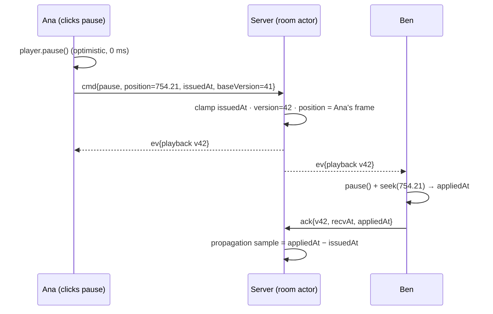
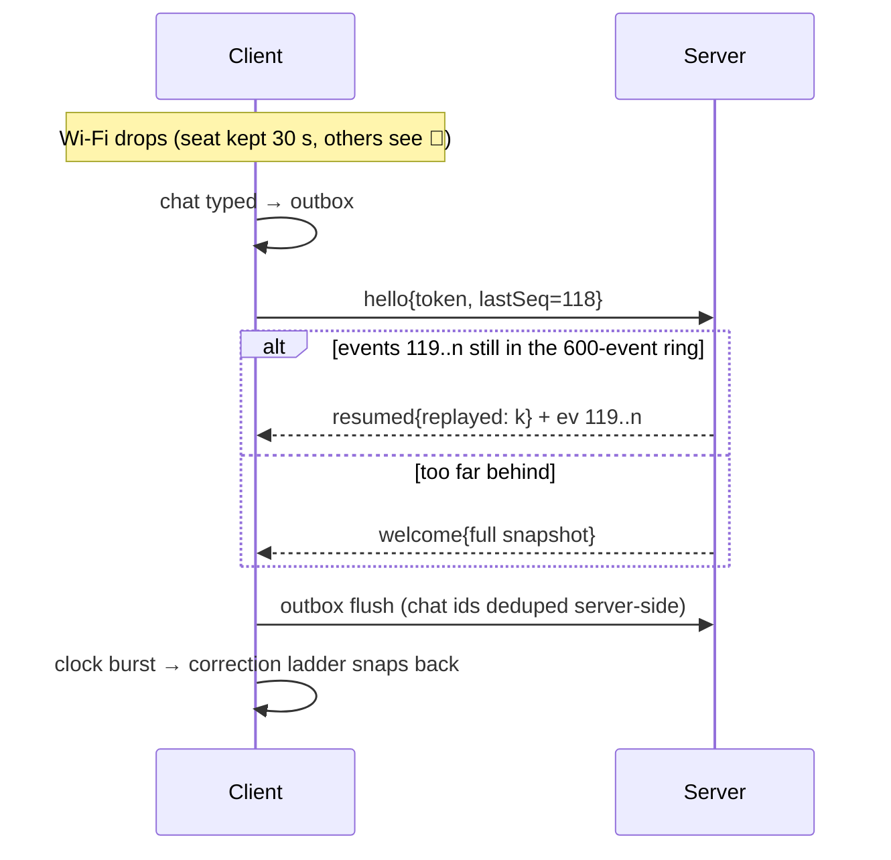
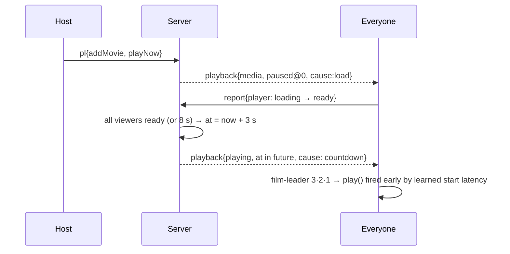

# Architecture

```
 Browser (×N)                                       Node process (one per party host)
┌──────────────────────────────┐   WebSocket /ws  ┌─────────────────────────────────────┐
│ React UI  ←→  Zustand store  │   JSON frames    │ Gateway  zod validation · rate limits│
│ RoomClient                   │◄────────────────►│          liveness · clock pongs      │
│  ├ ClockEstimator (NTP-style)│                  │          Chaos delay lines           │
│  ├ outbox + resume(lastSeq)  │                  │ RoomManager ─► Room actor (1/room)   │
│ SyncEngine                   │                  │   ├ playback anchor + version        │
│  ├ correction ladder (200 ms)│                  │   ├ 600-event replay ring            │
│  └ PlayerAdapter             │   HTTP           │   ├ votes · polls · Group Pick       │
│     HTML5 · HLS · YouTube ·  │◄────────────────►│   └ reaction batching · heatmap      │
│     local file               │  /api /metrics   │ Catalog  MiniSearch · moods · recs   │
└──────────────────────────────┘  /media          │ Metrics  propagation + drift rings   │
                                                  │ Persistence  data/rooms.json         │
                                                  └─────────────────────────────────────┘
          shared/  ← protocol.ts (zod schemas) · sync.ts (pure math) · types.ts
                     used by the browser, the server AND the benchmark bots
```

## Design decisions

### 1. The server is the single authority; rooms are actors
Node's event loop processes one message at a time, and each room owns its state. Every command is therefore applied atomically, in arrival order: **concurrency is solved by construction**, not by locks. Every change bumps a monotonically increasing `version` and is broadcast as a **sequenced, idempotent event** (`{e:'playback', playback}` replaces state rather than diffing it). That's what makes replay-after-reconnect safe.

### 2. Playback is an anchor, not a "current time"
```ts
{ status: 'playing', position: 754.20, at: <server ms>, rate: 1, version: 42 }
expected(now) = playing ? position + (now − at)/1000 × rate : position
```
* No periodic time broadcasts. Any client can compute where the room is at any instant.
* **Late join** = receive the anchor and compute. Nobody else is involved.
* **Countdown starts** come for free: put `at` in the future, and every device's leader counts down from the same number.
* **Server restarts** keep the anchor valid, because the clock is epoch-based.

### 3. Anchor at the click, not at arrival
The command carries `issuedAt`, the initiator's click time on the server clock. The server clamps it to `[max(now − 1 s, lastChange), now]` and uses it as `at`. The initiator applied optimistically at click time, so it's already exactly in sync. Receivers compensate the transit delay through `expected()`. For pauses, the server uses the initiator's **exact frame position**, so every screen freezes on the same frame.

### 4. Clock sync (NTP-style, monotonic)
4-timestamp exchange (`c0, s1, s2, c3`):
* Burst of 8 pings on connect, then one every 2.5 s (doubling as the app heartbeat).
* The estimate is the median offset of the **lowest-RTT third** of the last 24 samples (least queuing noise).
* Small changes are smoothed; jumps > 25 ms (sleep, clock step) are adopted immediately.
* Both sides use `performance.timeOrigin + performance.now()`, so wall-clock adjustments can't bend time.

### 5. Correction ladder (every 200 ms)
| \|drift\| | Action |
|---|---|
| < 40 ms | nothing (dead zone; hysteresis exits at 15 ms) |
| 40 ms – 1 s | `playbackRate = 1 − drift/2 s`, clamped to ±8 %, pitch preserved |
| ≥ 1 s (HTML5) / ≥ 350 ms (YouTube) | seek to `expected + learnedSeekLead`, then a 900 ms cooldown |

* YouTube exposes only a few fixed rates, so it uses the seek-only ladder. `getCurrentTime()` is interpolated between its coarse updates.
* Seek and start latencies are **learned per device** (EWMA) and used as lead times.

### 6. Echo suppression
User intent only ever comes from Marquee's own controls, never from `<video>` events. Native controls are off, and the YouTube iframe sits under an input shield. Applying a remote command therefore can't re-broadcast itself, avoiding the classic feedback loop of sync apps.

## Key flows







## Group recommender
* Each movie becomes a sparse vector: genres 1.0, keywords 0.55, director 0.9, top cast 0.45, decade 0.35, non-English language 0.3, mood 0.4. Vectors are L2-normalised.
* Each member's taste = Σ liked − 0.8 · Σ disliked (from Group Pick swipes, queued and suggested titles).
* Room score = 0.65 · mean(cosine) + 0.10 · min(cosine) + 0.25 · quality prior. Candidates anyone scores below −0.12 are **dropped** ("average without misery").
* Greedy MMR re-ranking (λ = 0.35) keeps the shortlist diverse.
* Every pick explains itself: "Because Ana liked *Arrival* and Ben liked *Interstellar*".

## Search
* MiniSearch index over title (×6), director (×2.5), cast (×2), keywords, genres, aliases and overview (×0.35).
* Typo-tolerant (edit distance 1 for terms of 4–6 characters, 2 for longer ones), prefix matching while typing, and diacritic folding.
* AND first, widening to OR when that's too strict.
* A small query language (`by:`, `with:`, `year:>2010`, `runtime:<120`, `rating:7+`, `mood:`, `is:free`, bare `90s` / `sci-fi`). The UI echoes back what it understood as chips.
* Results explain non-title matches ("Directed by Buster Keaton").
* Typical query time: 1–15 ms over ~1,000 films.

## Project layout
```
shared/    protocol.ts (zod) · sync.ts (anchor + ladder + clock) · types.ts · delay-queue.ts · util.ts
server/    index.ts (Fastify + static + uploads) · gateway.ts · room.ts (actor) · rooms.ts (persistence)
           metrics.ts · tunnel.ts · catalog/{catalog,query,recommend,tmdb}.ts
web/src/   net/client.ts · sync/engine.ts · players/{html5,youtube}.ts · store.ts
           pages/{Lobby,Room}.tsx · room/{Player,TheaterRow,Chat,Queue,Polls,People,Discover,GroupPick,SyncLab,Invite,Settings}.tsx
tools/     bot.ts · bench.ts · seed-archive.ts · seed-tmdb.ts
tests/     sync.test.ts · room.test.ts · catalog.test.ts
```

## Scaling path (beyond one box)
A room is a natural shard. Route `/ws?room=CODE` with sticky hashing to N processes, each owning its rooms. Swap `data/rooms.json` for Redis or Postgres snapshots. Nothing in the protocol assumes a single process except "one room lives in one process", which is exactly what makes it easy to reason about.
